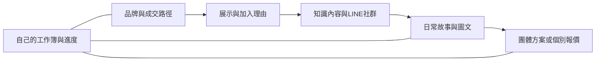

# 黃嘉偉KMW01私域社群變現

以內容引流、社群養客與適合產業的成交出口，串起品牌、展示、知識、日常圖文、團體方案與個別報價。適用文創、小農、活動服務、美業、保險等情境，依實際業務調整。

**公開試用交付版**｜Plugin0.5.3 · Skill0.7.7 · 學生導覽0.2.3

## 從這裡開始
- [學生使用、保存與更新步驟](STUDENT_GUIDE.md)
- [下載技能套件 ZIP](downloads/kmw01-community-monetization-0.5.3.zip?raw=true)
- [下載空白工作簿](downloads/我的私域社群工作簿_空白.md)
- [互動導覽原始檔](docs/index.html)：需要啟用網站托管後才是可操作網頁。
- [本次驗證與尚待實測項目](VALIDATION.md)

手機網頁的「新增 → 上傳外掛程式封存檔」直接上傳ZIP、不用提示詞，已由本人回報安裝成功；僅代表該帳號／介面。手機M01寫回Plugin在此環境不可用，改交完整工作簿與續接卡。新保存路線的手機新對話接續仍待驗證；這個倉庫沒有收單、收款或雲端記憶後台。

## 本版M03更新
喜好圖→一頁試版→本人確認→保存品牌版型卡；以後同品牌沿用。每篇封面實際製作、確認、放進原生cover並回讀。
- [M03完整方法](skills/creative-farm-business-workflow/references/m03-notion-layout.md)
- [有圖的版型範本](skills/creative-farm-business-workflow/assets/m03-notion-page-template.md)
- 示範圖只用於教學，不能自動當成學員品牌；手機與帳號實測仍需各自確認。

## 模組
| 模組 | 工作 |
|---|---|
| M00 | 整合進度與私人企劃續接 |
| M01 | 品牌、商品角色、本業與跨域常態需求 |
| M02 | 對外展示／內部靈感SiteMap與平台 |
| M03 | 顧客需求、知識文章、品牌封面及Notion |
| M04 | LINE社群承接與可掃描QR邀請海報 |
| M05 | 老師親授拍攝、選圖與Vivisticker |
| M06 | 三種固定故事寫法及文章／美編／做圖分支 |
| M07 | 團購、課程報名及團體方案 |
| M08 | 個別需求、Excel內部估算及Word客戶報價 |

## 檔案與更新
`plugin.json`與`skills/`是外掛本體，`docs/`是教學導覽，`downloads/`是交付檔；學生資料另存在本人私人位置。這裡是由老師P017正式來源產生的公開副本，方法更新先回正式來源再驗證發布，不回收私人品牌資料。

技術識別保留`w0001-creative-farm-workflow`供版本接續；對外顯示名稱統一「黃嘉偉KMW01私域社群變現」。字型來源與SIL OFL授權隨`docs/assets/fonts/`保留。

## 網站設定
要提供可操作的公開導覽，倉庫管理者可在Settings → Pages選擇main分支的/docs資料夾。網站啟用並實際回讀前，只把docs稱為導覽原始檔。
